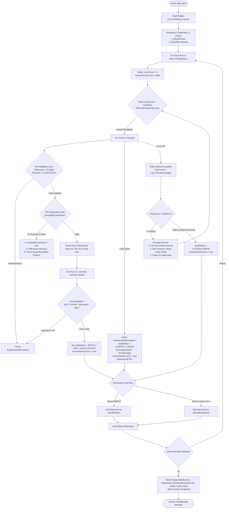

# Implementation Plan: Simulasi System Error (Auto-Retry & Re-Init) dan Pelaporan Excel Multi-Sheet

Dokumen ini menguraikan rencana perbaikan dan penambahan fitur pada alur kerja **RobotCoreBank** (Main.xaml) berdasarkan 2 kebutuhan baru:
1. **Eksperimen Simulasi System Error & Auto-Retry**: Menyimulasikan browser freeze pada transaksi ke-7, menjalankan prosedur **Re-Init** (membuka kembali browser), dan mengulang transaksi ke-7 hingga berhasil.
2. **Penyempurnaan Pelaporan Excel**: Memisahkan hasil audit menjadi 2 sheet terpisah pada file Data\Audit_CleanAndException.xlsx:
   - Sheet 1: `Audit_Clean` (khusus transaksi SUCCESS / MATCH)
   - Sheet 2: `Audit_Exceptions` (khusus transaksi berstatus BRE atau SE)

---

## 1. Goal Description

Alur kerja audit core banking akan ditingkatkan ke standar enterprise **REFramework Exception Handling** dengan membedakan secara tegas antara:
- **Business Rule Exception (BRE)**: Anomali data bisnis (seperti rekening != 10 digit atau data mismatch dengan portal). BRE **tidak di-retry** karena data input tidak akan berubah, melainkan langsung dicatat ke sheet `Audit_Exceptions`.
- **System Exception (SE)**: Kegagalan teknis infrastruktur/aplikasi (browser freeze, crash, network timeout). SE **wajib di-retry** (maksimal 3 kali) dengan prosedur **Re-Init** (menutup paksa sisa proses browser dan meluncurkan ulang web portal) sebelum mengulang transaksi yang sama.

Pada transaksi ke-7 (`TRX-2026-0007`), robot akan memicu simulasi crash pada percobaan pertama untuk menguji mekanisme Re-Init dan auto-retry hingga berhasil.

---

## 2. User Review Required

> [!IMPORTANT]
> **Dukungan Fleksibel Browser (Edge & Chrome):**
> Anda menyebutkan "Tutup Google Chrome secara paksa", sedangkan pada pengujian sebelumnya kita menggunakan Microsoft Edge. 
> - Alur kerja akan dibuat fleksibel menggunakan penamaan proses dinamis (`msedge` atau `chrome`) dan selector berbasis `app='*.exe' title='Bank Nusantara - Live Settlement Monitoring Portal (Day 30 Enterprise REFramework)'`.
> - Robot dapat mendeteksi browser apa pun yang sedang Anda gunakan (Edge maupun Google Chrome).

> [!NOTE]
> **Mekanisme Simulasi Freeze Transaksi ke-7:**
> Simulasi crash akan otomatis dipicu pada `searchTransactionID == "TRX-2026-0007"` saat `simulatedCrashDone == false`:
> 1. Robot mencatat log peringatan simulasi crash.
> 2. Robot mematikan proses browser secara paksa (`Kill Process`).
> 3. Robot melempar `SystemException: "[SE Simulasi] Browser Freeze pada transaksi ke-7!"`.
> 4. Blok Catch SE menangkap error, memicu prosedur Re-Init (membuka kembali portal), menaikkan `retryCount`, dan mencoba ulang `TRX-2026-0007`.
> 5. Pada percobaan kedua, transaksi ke-7 berhasil diekstrak dan masuk ke sheet `Audit_Clean`.

---

## 3. Workflow Architecture & Diagram



---

## 4. Proposed Changes

### Component: `Main.xaml`

#### 1. Penambahan Variabel Pengendali Retry & Multi-Sheet
- `dtAuditClean` (`System.Data.DataTable`): Menampung baris transaksi sukses/bersih.
- `dtAuditExceptions` (`System.Data.DataTable`): Menampung baris transaksi anomali (BRE) atau error sistem (SE).
- `simulatedCrashDone` (`System.Boolean`, default: `false`): Memastikan simulasi crash ke-7 hanya terjadi 1 kali.
- `retryCount` (`System.Int32`): Menghitung iterasi retry per transaksi.
- `maxRetry` (`System.Int32`, default: `3`): Batas maksimal retry transaksi.
- `transactionSuccess` (`System.Boolean`): Indikator keluar dari loop retry.
- `browserExe` (`System.String`, default: `"msedge"` atau `"chrome"`): Proses browser yang dikontrol.

#### 2. Inisialisasi Dua DataTable (11 Kolom)
```csharp
dtAuditClean = new System.Data.DataTable("Audit_Clean") {
    Columns = {
        "ID_Transaksi", "Waktu_Transaksi", "No_Rekening", 
        "Channel_Core", "Nominal_Core", "Status_Core",
        "Web_Channel", "Web_Nominal", "Web_Status", 
        "Audit_Status", "Keterangan_Audit"
    }
};

dtAuditExceptions = new System.Data.DataTable("Audit_Exceptions") {
    Columns = {
        "ID_Transaksi", "Waktu_Transaksi", "No_Rekening", 
        "Channel_Core", "Nominal_Core", "Status_Core",
        "Web_Channel", "Web_Nominal", "Web_Status", 
        "Audit_Status", "Keterangan_Audit"
    }
};
```

#### 3. Logika Simulasi Crash pada Transaksi ke-7
Di dalam `Try`, sebelum pencarian web:
```csharp
if (searchTransactionID == "TRX-2026-0007" && !simulatedCrashDone)
{
    simulatedCrashDone = true;
    // Log simulasi
    // Kill Process msedge/chrome
    // Throw new System.Exception("[SE Simulasi] Browser freeze / crash secara paksa pada transaksi ke-7!")
}
```

#### 4. Prosedur Re-Init di dalam Catch `System.Exception`
Saat tertangkap `System.Exception`:
```csharp
retryCount++;
if (retryCount < maxRetry)
{
    // Log Re-Init
    // 1. Kill Process browser yang hang
    // 2. Luncurkan ulang URL portal web
    // 3. Delay 2 detik untuk stabilisasi rendering
    // 4. Lanjut ke iterasi while berikutnya (mengulang baris yang sama)
}
else
{
    auditStatus = "SYSTEM_ERROR";
    keteranganAudit = "[SE Gagal setelah " + maxRetry.ToString() + "x retry] " + se.Message;
    transactionSuccess = true;
}
```

#### 5. Pemisahan Alokasi Row ke `dtAuditClean` vs `dtAuditExceptions`
Setelah transaksi selesai (baik sukses, lolos AML, maupun exception):
```csharp
var rowData = new object[] {
    searchTransactionID, waktu, rek, channelCore, nominalCore, statusCore,
    channel, nominal, status, auditStatus, keteranganAudit
};

if (auditStatus == "MATCH" || auditStatus == "MATCH (HIGH_VALUE_REVIEW)")
{
    dtAuditClean.Rows.Add(rowData);
}
else
{
    dtAuditExceptions.Rows.Add(rowData);
}
```

#### 6. Penulisan ke File `Data\Audit_CleanAndException.xlsx`
Menggunakan aktivitas `WriteRange` terpisah:
1. **Sheet `Audit_Clean`**:
   - `WorkbookPath`: `"Data\Audit_CleanAndException.xlsx"`
   - `SheetName`: `"Audit_Clean"`
   - `DataTable`: `dtAuditClean`
   - `AddHeaders`: `True`
2. **Sheet `Audit_Exceptions`**:
   - `WorkbookPath`: `"Data\Audit_CleanAndException.xlsx"`
   - `SheetName`: `"Audit_Exceptions"`
   - `DataTable`: `dtAuditExceptions`
   - `AddHeaders`: `True`

---

## 5. Verification Plan

### Automated Checks
1. Memeriksa integritas skema file XML `Main.xaml` via Python XML parser.
2. Memastikan tidak ada error kompilasi C# (bebas dari `CS0834` dan `CS8198`).
3. Memverifikasi struktur file output `Audit_CleanAndException.xlsx` memiliki 2 sheet dengan 11 kolom.

### Manual Verification oleh User
1. Buka portal di browser (Edge / Chrome).
2. Jalankan `Main.xaml` via **Run File (`Ctrl + F5`)**.
3. Amati log di panel Output:
   - Baris 1-6 berjalan normal.
   - Pada baris ke-7 (`TRX-2026-0007`), amati log simulasi crash: browser tertutup secara paksa.
   - Amati log Re-Init: browser dibuka kembali, navigasi ke portal monitoring.
   - Transaksi ke-7 diulang kembali dan berhasil diproses.
   - Transaksi 8-25 selesai diproses hingga akhir.
4. Buka file hasil: Data\Audit_CleanAndException.xlsx:
   - **Sheet `Audit_Clean`**: Berisi seluruh transaksi sukses (termasuk `TRX-2026-0007` yang berhasil setelah retry, dan transaksi AML high value).
   - **Sheet `Audit_Exceptions`**: Berisi seluruh anomali fraud (rekening tidak valid, nominal 0 sukses, mismatch).
