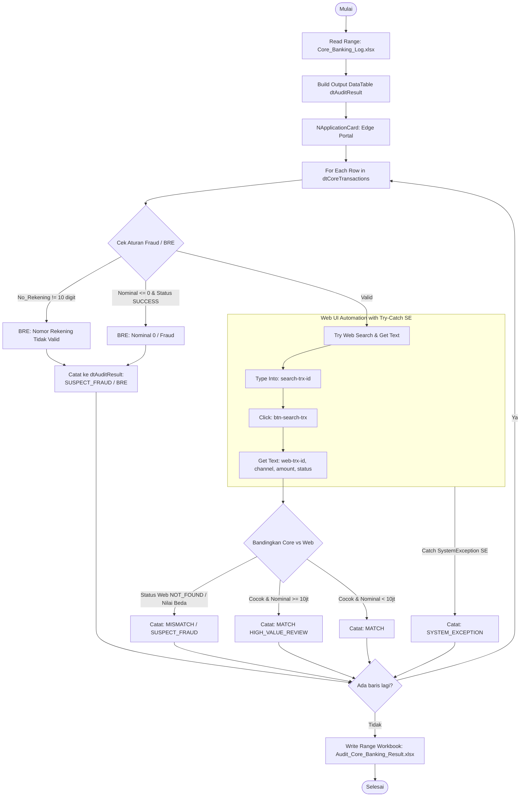

# Implementation Plan: UiPath Core Banking Transaction Audit & Fraud Detection

## 1. Goal Description
Implement an end-to-end automated audit workflow in UiPath (`Main.xaml`, C# expression language) that:
1. Fixes the issue where `Get Text` does not output values to `WriteLine` due to hardcoded text selectors.
2. Reads transaction data from `Core_Banking_Log.xlsx` (`Core_Transactions` sheet).
3. Evaluates fraud & business rules using **BusinessRuleException (BRE)**:
   - Invalid account numbers (`No_Rekening` length != 10 digits).
   - Zero or invalid nominal amounts (`Nominal_Core <= 0` with status `SUCCESS`).
4. Performs Web Portal lookups on `banking-monitoring-portal.html` in Microsoft Edge for valid transactions:
   - Handles **SystemException (SE)** for application errors (browser crash, selector timeout, network failure).
5. Compares Core Banking values with Web Portal values:
   - High-value transactions ($\ge \text{Rp } 10.000.000$) flagged as `MATCH (HIGH_VALUE_REVIEW)` for AML review.
   - Matching transactions marked as `MATCH`.
   - Mismatches or `NOT_FOUND` flagged as `MISMATCH / SUSPECT_FRAUD`.
6. Writes comprehensive audit results to `Audit_Core_Banking_Result.xlsx` (`Audit_Result` sheet).
7. Explores browser inspection & MCP integration.

---

## 2. Analisis Masalah: Get Text Belum Tampil di Write Line

### Penyebab Utama (Root Cause):
Pada `Main.xaml` yang ada saat ini, aktivitas `NGetText` menggunakan selector desktop accessibility dengan teks yang di-hardcode ke data rekaman pertama:
- **ID Transaksi**: `<ctrl name='TRX-2026-0001' role='text' />`
- **Channel**: `<ctrl name='BI-FAST' role='text' />`
- **Nominal**: `<ctrl name='1500000' role='text' />`
- **Status**: `<ctrl name='SUCCESS' role='text' />`

Ketika robot mencari ID transaksi lain (misalnya `TRX-2026-0002`), halaman web menampilkan teks `TRX-2026-0002` dan `250000`. Selector UiPath tetap mencari teks `'TRX-2026-0001'`, sehingga aktivitas `Get Text` gagal menemukan elemen atau menghasilkan nilai kosong (`null`), yang menyebabkan `WriteLine` tidak menampilkan hasil yang diharapkan.

### Solusi Perbaikan:
Ganti selector teks statis menjadi HTML Web Selector yang dinamis mengacu langsung pada elemen `id` di DOM:
- **ID Transaksi**: `<webctrl id='web-trx-id' tag='SPAN' />`
- **Channel**: `<webctrl id='web-trx-channel' tag='SPAN' />`
- **Nominal**: `<webctrl id='web-trx-amount' tag='SPAN' />`
- **Status**: `<webctrl id='web-trx-status' tag='SPAN' />`

---

## 3. Alur Kerja (Workflow Architecture)

---

## 4. Rincian Implementasi

### A. Membaca Data Transaksi Excel
- File: `Core_Banking_Log.xlsx`
- Sheet: `Core_Transactions`
- Activity: `UiPath.Excel.Activities.ReadRangeWorkbook`
- Output: `dtCoreTransactions` (`System.Data.DataTable`)

### B. Inisialisasi DataTable Hasil Audit
- Activity: `UiPath.Core.Activities.BuildDataTable`
- Output: `dtAuditResult` (`System.Data.DataTable`)
- Struktur Kolom (11 Kolom):
  1. `ID_Transaksi`
  2. `Waktu_Transaksi`
  3. `No_Rekening`
  4. `Channel_Core`
  5. `Nominal_Core`
  6. `Status_Core`
  7. `Web_Channel`
  8. `Web_Nominal`
  9. `Web_Status`
  10. `Audit_Status`
  11. `Keterangan_Audit`

### C. Logika Fraud Check & BusinessRuleException (BRE)
1. **Aturan Rekening**:
   - Kondisi C#: `CurrentRow["No_Rekening"].ToString().Trim().Length != 10`
   - Tindakan: Set `Audit_Status = "SUSPECT_FRAUD / BRE"`, `Keterangan_Audit = "[BRE] Nomor rekening tidak valid (" + CurrentRow["No_Rekening"].ToString() + "): panjang bukan 10 digit (Suspect Anomali/Fraud)"`.
   - Web Channel/Nominal/Status diisi `"-"` (tidak perlu pencarian web).
2. **Aturan Nominal 0 / Status SUCCESS**:
   - Kondisi C#: `Convert.ToDecimal(CurrentRow["Nominal_Core"]) <= 0 && CurrentRow["Status_Core"].ToString().ToUpper() == "SUCCESS"`
   - Tindakan: Set `Audit_Status = "SUSPECT_FRAUD / BRE"`, `Keterangan_Audit = "[BRE] Nominal transaksi tidak valid / 0 (" + CurrentRow["Nominal_Core"].ToString() + ") dengan status SUCCESS (Suspect Fraud)"`.
   - Web Channel/Nominal/Status diisi `"-"`.

### D. Interaksi Web Portal & Penanganan SystemException (SE)
- Menggunakan `TryCatch`:
  - `Try`:
    - `NTypeInto`: Masukkan `CurrentRow["ID_Transaksi"].ToString()` ke `#search-trx-id`.
    - `NClick`: Klik `#btn-search-trx`.
    - `NGetText` (4x): Ambil `#web-trx-id`, `#web-trx-channel`, `#web-trx-amount`, `#web-trx-status`.
    - `WriteLine`: `transactionID + " | " + channel + " | " + nominal + " | " + status`.
    - Cek Hasil:
      - Jika `webStatus == "NOT_FOUND"` atau data tidak cocok:
        - `Audit_Status = "MISMATCH / SUSPECT_FRAUD"`
        - `Keterangan_Audit = "[BRE] Data transaksi tidak ditemukan di Web Portal atau berbeda"`
      - Jika cocok dan `Convert.ToDecimal(CurrentRow["Nominal_Core"]) >= 10000000`:
        - `Audit_Status = "MATCH (HIGH_VALUE_REVIEW)"`
        - `Keterangan_Audit = "Transaksi valid namun nominal tinggi (>= 10 jt) wajib review AML"`
      - Jika cocok:
        - `Audit_Status = "MATCH"`
        - `Keterangan_Audit = "Data sesuai dengan Web Portal"`
  - `Catch (System.Exception ex)`:
    - `Audit_Status = "SYSTEM_EXCEPTION / SE"`
    - `Keterangan_Audit = "[SE] " + ex.Message`

### E. Menyimpan Hasil Audit ke Excel
- File: `Audit_Core_Banking_Result.xlsx`
- Sheet: `Audit_Result`
- Activity: `UiPath.Excel.Activities.WriteRangeWorkbook` (Write DataTable `dtAuditResult`).

### F. Terkait MCP Browser (`https://github.com/browsermcp/mcp`)
- BrowserMCP adalah MCP server untuk integrasi AI dengan Chromium DevTools protocol.
- Di lingkungan Antigravity ini, sudah ada built-in subagent `browser` dengan Chrome DevTools protocol.
- Untuk automasi RPA UiPath, eksekusi dilakukan secara native oleh paket `UiPath.UIAutomation.Activities` melalui Microsoft Edge.

---

## 5. Rencana Verifikasi
1. Validasi struktur file `Main.xaml` dan kecocokan sintaks C#.
2. Buka `banking-monitoring-portal.html` di Edge.
3. Jalankan `Main.xaml` dari UiPath Studio.
4. Periksa Output Panel untuk memastikan `WriteLine` menampilkan nilai hasil `Get Text` setiap baris transaksi.
5. Verifikasi isi file `Audit_Core_Banking_Result.xlsx`:
   - `TRX-2026-0005` (Rekening `12345`) $\rightarrow$ `SUSPECT_FRAUD / BRE`
   - `TRX-2026-0008` (Nominal `12000000`) $\rightarrow$ `MATCH (HIGH_VALUE_REVIEW)`
   - `TRX-2026-0013` (Nominal `0`) $\rightarrow$ `SUSPECT_FRAUD / BRE`
   - `TRX-2026-0018` (Rekening `9988`) $\rightarrow$ `SUSPECT_FRAUD / BRE`
   - Transaksi normal $\rightarrow$ `MATCH`

---

## CATATAN TAMBAHAN
Menyertakan Activity Log dan Komentar